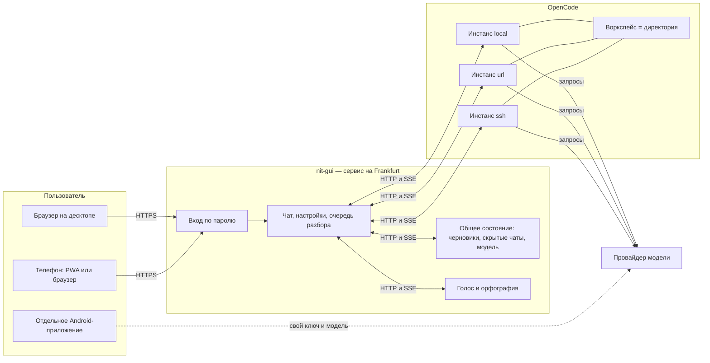

# Карта системы

## Что это

Одна мастер-диаграмма: кто с кем говорит и где проходят границы. Только границы и
потоки, без файлов и классов.

Пользователь просил именно такой артефакт: «я бы еще хотел чтобы в этих виденьях была
какая-то мастер диаграмма» — ses_e489feeacffeKQhDgPsPs8MDY8, 2026-11-07.

## Что снаружи

- **Провайдер модели** — единственный внешний вызов; к нему ходит OpenCode, а не
  браузер. «Приложение не открывает второй канал к моделям».
- **Устройство пользователя** — браузер, микрофон, динамик. Клиент тонкий: «на клиента
  полагается не стоит, что у него что-то есть(tts там)» — ses_e4dc6666cffeDgGGFU2DIrpzJo,
  2026-11-06.
- **Публичный вход** — TLS и адрес снаружи, перед паролем приложения: «размести на
  каком-то /nit поддомене наш сервис. предварительно сделав /auth страничку» —
  ses_e4dc6666cffeDgGGFU2DIrpzJo, 2026-11-06.
- **Директории на машинах инстансов** — воркспейсы; их выбирает пользователь, и у
  каждого инстанса они свои: «выбор нужной дериктории для работы будет разным под
  какждый инстанс» — ses_e503eb2beffe9kyNgla0cCMQRc, 2026-11-06.
- **Отдельное Android-приложение** — другой продукт на том же ключе и модели, вне
  границы nit-gui: «поскольку это для личного пользования Я думаю мы можем
  использовать тот же самый ключ и тот же самый модель» — ses_e4a63839fffeVH0kVfl8ae1J0N,
  2026-11-07.

## Связи

- [[architecture]] — что внутри границы nit-gui.
- [[instances]] — что такое инстанс и воркспейс.
- [[access]] — как пользователь попадает внутрь.
- [[constraints]] — чего на карте быть не должно.

## Критерии приёмки

- На диаграмме видны три границы: пользователь, nit-gui, OpenCode; воркспейс
  нарисован внутри OpenCode, а не в nit-gui.
- Единственная стрелка к провайдеру модели выходит из OpenCode.
- В списке «что снаружи» нет частей, которые на самом деле живут на Frankfurt.

## Открытые вопросы

- Где на карте стоят независимые агенты: внутри nit-gui как обычные чаты или
  отдельной петлёй с очередью разбора? Пользователь просил «уместить в нынешнюю
  модель взаимодействия», но места не назвал.
- Отдельное Android-приложение использует «готовый бекенд opencode» — это тот же
  инстанс, что у nit-gui, или свой?
